<a href="https://keelinfra.io">
  <picture>
    <source media="(prefers-color-scheme: dark)" srcset=".github/readme/hero-dark.svg">
    
  </picture>
</a>

<p align="center">
  <a href="https://github.com/keelinfra/release-integrity/actions/workflows/scan.yml"></a>
  <a href="https://github.com/keelinfra/release-integrity/actions/workflows/test.yml"></a>
  <a href="results/trend.csv"></a>
  <a href="results"></a>
  <a href="#license"></a>
</p>

<p align="center">
  <a href="#what-it-checks"><b>What it checks</b></a> &nbsp;·&nbsp;
  <a href="#results"><b>Results</b></a> &nbsp;·&nbsp;
  <a href="#run-it-yourself"><b>Run it yourself</b></a> &nbsp;·&nbsp;
  <a href="https://shenxianpeng.dev/posts/2026/swappable-github-releases/"><b>Write-up</b></a>
</p>

<br>

Could someone with write access to a repository replace the files in its **latest GitHub release**, and would a downloader be able to tell?

Once a month, [`scan.py`](scan.py) takes every **Go and Rust repository tagged `cli` with at least 1,000 stars**, keeps those whose latest release is under a year old and ships binaries, and records how that latest release is protected.

## What it checks

| Column | Meaning |
|---|---|
| `immutable` | GitHub [immutable releases](https://docs.github.com/en/code-security/concepts/supply-chain-security/immutable-releases) are on: files can't be replaced, the tag can't move |
| `provenance` | a GitHub build-provenance attestation exists for its binaries (up to two binaries and one checksum file are looked up) |
| `signed` | it ships signature files (cosign/Sigstore, GPG, minisign, SLSA `.intoto.jsonl`) |
| `checksums` | it ships a checksum file |
| `verdict` | the strongest of the above |

> [!IMPORTANT]
> `checksums only` and `nothing` count as **swappable**. A checksum file on its own doesn't help: whoever can replace a binary can replace the checksum file next to it.

## Results

| File | What's in it |
|---|---|
| [`results/latest.json`](results/latest.json) | the latest totals, which the badges above read |
| [`results/trend.csv`](results/trend.csv) | one line per run |
| [`results/`](results) | one directory per run, with every repository's row |

The scan runs on the 3rd of each month from [`.github/workflows/scan.yml`](.github/workflows/scan.yml) and commits its results here. The set of repositories is re-queried each month, so it changes as projects cross 1,000 stars or stop releasing. Repositories the token can't read are skipped and listed under `skipped` in `results.json`.

## Run it yourself

With a token that can read public repositories (Python 3, standard library only):

```sh
GITHUB_TOKEN=... python3 scan.py --out /tmp/scan
GITHUB_TOKEN=... python3 scan.py --repos owner/repo another/repo --out /tmp/scan
python3 -m unittest discover -s tests    # offline tests
```

A full run takes about 950 API calls and a few minutes.

## Read more

The first write-up, with what maintainers can do about it: [English](https://shenxianpeng.dev/posts/2026/swappable-github-releases/) · [中文](https://shenxianpeng.dev/zh-cn/posts/2026/swappable-github-releases/).

## Get involved

> [!TIP]
> If a result about your project looks wrong, for example it was checked before you turned on immutable releases, [open an issue](https://github.com/keelinfra/release-integrity/issues). Results are a snapshot of the latest release on the day of the run; the next monthly run picks up changes on its own.

Security problems in `scan.py` or the workflow: see [SECURITY.md](SECURITY.md).

## License

The script is under the [Apache License 2.0](LICENSE); the data in `results/` is under [CC BY 4.0](https://creativecommons.org/licenses/by/4.0/).

<br>

<p align="center">
  <a href="https://keelinfra.io"></a>
  <br>
  <sub>
    Made by <a href="https://keelinfra.io"><b>keelinfra</b></a>: tested, open-source builds for CI that can't upgrade yet.<br>
    <a href="https://github.com/keelinfra/jenkins-extended-security">Extended Security for Jenkins 2.541.x</a> &nbsp;·&nbsp;
    <a href="https://github.com/keelinfra/agent8">Agent8 for Jenkins</a> &nbsp;·&nbsp;
    <a href="https://keelinfra.io/jenkins/upgrade-matrix/">Jenkins upgrade matrix</a> &nbsp;·&nbsp;
    <a href="https://github.com/keelinfra/aix-runner">AIX Runner for GitLab</a>
  </sub>
</p>
